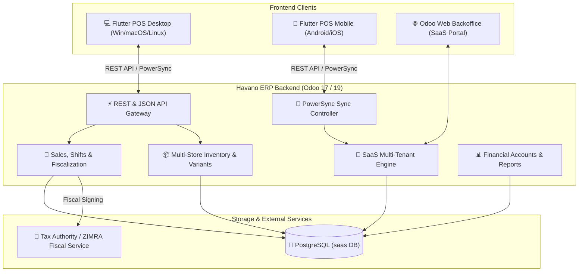

# ⚡ Havano ERP (`havanoposdesk_odoo`)

<div align="center">


**The Unified Multi-Tenant Cloud ERP Backend powering Havano Flutter POS (Desktop & Mobile) and Odoo Web Backoffice.**

[Key Features](#-key-features) • [Architecture](#-architecture) • [Module Structure](#-module-structure) • [REST API Reference](#-rest-api-reference) • [Smart Import](#-smart-import-engine) • [Deployment](#-deployment--cicd) • [License](#-license)

---

</div>

## 📖 Overview

**Havano ERP (`havanoposdesk_odoo`)** is a high-performance, enterprise-grade Odoo backend module engineered for high-volume retail, wholesale, restaurant, and manufacturing operations. It acts as the central brain connecting multi-tenant web backoffices with native **Flutter POS** (Windows, macOS, Linux, Android, iOS) clients operating both online and offline.

---

## 🚀 Key Features

### 🏢 Multi-Tenant SaaS Core
- **Complete Tenant Isolation**: Multi-tenant architecture isolating stores, inventory, users, and transactions per organization.
- **Tenant Lifecycle Management**: Automated trial tracking, subscription tiers, renewal alerts, and tenant status monitors.
- **White-Label Branding**: Dynamic company branding, custom login portals, automated invoices, and system theme personalization.
- **Sub-Second Analytics**: Direct SQL aggregate calculation for instant loading across hundreds of thousands of tenant transactions.

### 🛒 Point of Sale & Branch Operations
- **Hardware Terminal Binding**: Cryptographic device UUID binding with automatic terminal-to-store assignment.
- **Multi-Store Cashier Permissions**: Cashiers can seamlessly switch between authorized branch stores with granular permission profiles.
- **Cashier Shifts & Float Management**: Opening floats, mid-day cash adjustments, cash drawer reconciliation, and end-of-shift X/Z audit reports.
- **Inter-Store Cash Transfers**: Secure branch-to-branch cash movement with dual-step approval workflows.

### 📦 Inventory, Variants & Packaging
- **Dynamic Product Variants**: Multi-attribute matrix generation (Sizes, Colors, Dimensions) with variant selector wizards.
- **Sub-Units & Packaging**: Support for multi-level packaging (Units, Boxes, Cartons, Pallets) with automated cost/price conversion ratios.
- **Multi-Branch Warehouses**: Real-time stock visibility across branches with inter-warehouse stock transfer approvals.
- **Bill of Materials & Bundles**: Combo packs, recipe kits, and assembly products with automatic raw material deductions.

### ⚡ Smart Bulk Import Engine
- **Excel & CSV Ingestion**: Drag-and-drop Smart Import buttons directly integrated into Sales and Purchases list headers.
- **Automated Line Mapping**: Validates item SKUs, tax templates, quantities, and pricing with instant preview before database commit.
- **Idempotency & Integrity**: Automatic duplicate invoice detection and atomic transaction rollback on validation failure.

### 🧾 Fiscalization & Regulatory Compliance
- **Real-Time Tax Authority Sync**: Native integration with fiscal providers (e.g., ZIMRA fiscal devices and online fiscalization services).
- **Fiscal Tax Invoices**: QR code verification URLs, cryptographic signatures, device serial numbers, and sequential fiscal counters.

### 🔄 Offline-First Real-Time Sync
- **PowerSync Integration**: Bidirectional SQLite/PostgreSQL sync keeping offline Flutter POS stations up to date.
- **Debounced Heartbeats**: Ultra-lean terminal heartbeat pinging with zero database bloat and fast status updates.

---

## 🏛️ Architecture



---

## 📁 Module Structure

```plaintext
havanoposdesk_odoo/
├── core/                       # SaaS Multi-Tenancy & Platform Administration
│   ├── models/                 # Tenant, Store, Terminal, User Rights, Audit Mixins
│   ├── controllers/            # Main Web & Whitelabel controllers
│   └── views/                  # Backoffice management menus and views
├── sales/                      # Invoicing, Shifts, Returns & POS Reporting
│   ├── models/                 # Sales Invoices, Lines, Shift Balances, Ledgers
│   ├── wizard/                 # Sale Return Wizard, Smart Sale Import Wizard
│   └── views/                  # Tree/Form/Pivot views, Reports & PDF Templates
├── inventory/                  # Stock Management, Packaging & Catalog
│   ├── models/                 # Products, Variants, Categories, Sub-Units, Transfers
│   ├── controllers/            # POS REST endpoints & Product synchronization
│   └── views/                  # Product matrices, Category hierarchies, Stock moves
├── accounts/                   # Financials, Taxes & Payments
│   ├── models/                 # Chart of accounts, Expenses, Taxes, Payment gateways
│   └── views/                  # P&L widgets, Cashbooks, Expense trackers
├── manufacturing/              # Light Manufacturing & Production Orders
│   ├── models/                 # Bill of Materials (BOM), Production work orders
│   └── views/                  # Work center and production forms
├── suppliers/                  # Purchasing, Vendors & Stock Inflow
│   ├── models/                 # Vendor bills, Purchase orders, Suppliers
│   └── wizard/                 # Smart Purchase Import Wizard
├── static/                     # Web Assets, Themes, Charts & JavaScript
│   ├── src/dashboard/          # Owl Framework & ApexCharts SaaS Dashboard
│   ├── src/js/                 # Smart import overrides, section lines, dialogs
│   └── src/scss/               # Modern responsive theme styles & custom themes
└── .github/workflows/          # CI/CD automated deployment workflows
```

---

## 🔌 REST API Reference

The module provides high-speed endpoints for client terminals:

### 1. Authentication & Store Selection
| Method | Endpoint | Description |
| :--- | :--- | :--- |
| `POST` | `/api/user/login` | Authenticate cashier, returns JWT token, allowed stores, and permission profile. |
| `GET` | `/api/user/shops` | List stores/branches accessible by the authenticated cashier. |
| `POST` | `/api/user/select-shop` | Bind POS hardware terminal ID to a store session. |

### 2. Product Catalog Synchronization
| Method | Endpoint | Description |
| :--- | :--- | :--- |
| `GET` | `/api/method/havano_pos_integration.api.get_products` | Full product catalog with barcode, multi-UoM packaging, variant attributes, and store-specific pricelists. |
| `GET` | `/api/categories` | Complete category hierarchy including sub-unit classifications. |

### 3. POS Transactions & Invoicing
| Method | Endpoint | Description |
| :--- | :--- | :--- |
| `POST` | `/saas_api/make_sale` | Submit offline or online POS sales invoice with payments, customer, and tax lines. |
| `POST` | `/api/sale/credit-note` | Issue credit notes with automated stock replenishment. |

### 4. Cashier Shift Management
| Method | Endpoint | Description |
| :--- | :--- | :--- |
| `POST` | `/api/pos/shift/open` | Open cashier shift with initial float balance. |
| `POST` | `/api/pos/shift/close` | Close shift, reconcile cash drawer, and generate Z-Report. |

---

## 📥 Smart Import Engine

Havano ERP includes dedicated bulk Excel/CSV import wizards for both Sales and Purchases:

1. **Header Action Button**: Navigate to **Sales > Orders** or **Purchases > Orders** and click the **Smart Import** button on the top-left list view header.
2. **Download Template**: Click **Download Sample Excel Template** for auto-populated column headers (`Invoice Number`, `Customer`, `Product SKU`, `Quantity`, `Price`, `Tax`).
3. **Upload & Validate**: Upload your spreadsheet; the wizard validates customer records, calculates taxes, and generates orders in Draft or Confirmed state.

---

## 🚢 Deployment & CI/CD

Automated deployment is configured via GitHub Actions (`.github/workflows/deploy.yml`):

### Supported Deployment Branches
- `develop` *(Active development & staging)*
- `master` *(Stable production release)*
- `main` *(Mirror production)*

### Server Pipeline Steps
1. **Repository Pull**: Clean fetch and hard-reset to avoid drift (`git checkout -B <branch> origin/<branch>`).
2. **Schema Migration**: Auto-executes `_auto_init` safeguards for columns, sequences, and indexes.
3. **Module Upgrade**: Updates views, menus, and models (`-u havanoposdesk_odoo`).
4. **Service Restart**: Restarts the system daemon (`sudo systemctl restart odoo`).

For complete setup instructions (SSH keys, secrets, sudoers), see [DEPLOYMENT.md](file:///opt/odoo-secure/addons-custom/havanoposdesk_odoo/DEPLOYMENT.md).

---

## ⚙️ Configuration & Installation

### Requirements
- Odoo 17.0+ or Odoo 19.0 (with Python 3.10+)
- PostgreSQL 14+
- Python packages: `psycopg2`, `openpyxl`, `xlsxwriter`, `requests`, `pyjwt`

### Installation Steps
```bash
# 1. Clone into your custom addons directory
cd /opt/odoo-secure/addons-custom
git clone https://github.com/draftpos/havanoposdesk_odoo.git

# 2. Add to addons_path in /etc/odoo/odoo.conf
# addons_path = /usr/lib/python3/dist-packages/odoo/addons,/opt/odoo-secure/addons-custom

# 3. Install the module on your database
odoo -c /etc/odoo/odoo.conf -d saas -i havanoposdesk_odoo --stop-after-init

# 4. Restart Odoo
sudo systemctl restart odoo
```

---

## 🛡️ License & Legal

```plaintext
Copyright (c) 2024-2026 Havano Tech. All Rights Reserved.

This software is proprietary and confidential. Unauthorized copying, distribution,
or modification of this file, via any medium, is strictly prohibited without the
express written permission of Havano.

Certain portions may be licensed under the GNU Lesser General Public License (LGPL v3)
as compatible with the Odoo Community framework.
```

---

<div align="center">
Made with ❤️ by the <b>Havano Engineering Team</b>.
</div>
